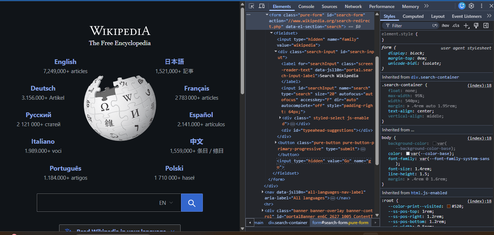

# DevTools Exploration

## Website 1: Example Domain
- URL: https://example.com
- HTML tags found: 
     <html> - the root of the HTML document.
     <head> — contains metadata.
     <title> — defines the page title.
     <body> — contains the visible page content.
     <h1> — displays the main heading.
     
 — displays paragraphs.
     - <a> — creates a hyperlink.
- Page title: Example Domain
- Number of headings: 1

## Website 2: MDN
- URL: https://developer.mozilla.org
- Navigation element: The navigation menu uses the <nav> HTML tag, which identifies a section containing navigation links. Inside it, you may find links (<a>), lists (<ul> and <li>)
- Search bar structure: The search bar is typically built using HTML form controls
- Hover styles: CSS :hover applies visual changes such as text color, background, underline, or cursor appearance. The exact effect varies by link.

## Website 3: [Website name]
- URL: https://www.wikipedia.org?utm_source=chatgpt.com
- Five HTML elements: <html>,<head>,<title>,<form>,<input>
- Form inputs: <input type="hidden" name="family" value="wikipedia">,<input id="searchInput" name="search" type="search" size="20" autofocus="autofocus" accesskey="F" dir="auto" autocomplete="off" style="padding-right: 64px;">,<input type="hidden" value="Go" name="go">
- Screenshot: 
